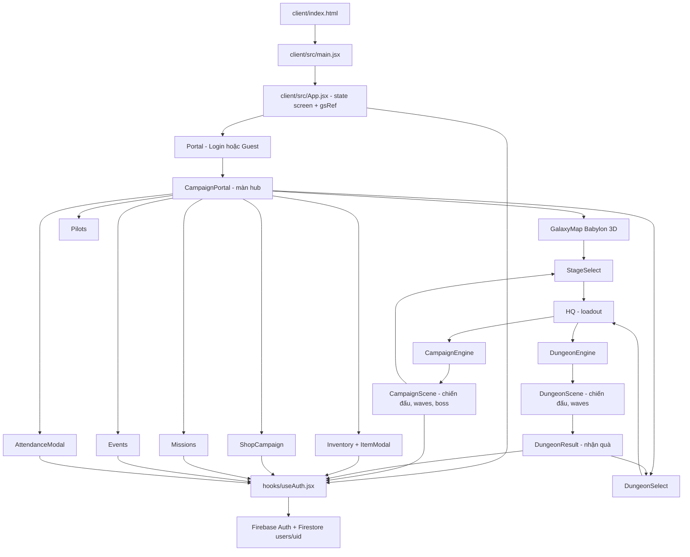

# BÁO CÁO ĐỌC MÃ NGUỒN VÀ BẢN ĐỒ LUỒNG CODE SPACE FIGHTER 4.0

**Ngày phân tích:** 16/10/2026  
**Mã nguồn đầu vào:** `spaceFighter.zip` (ZIP nguyên trạng)  
**Trạng thái:** Đã đọc mã nguồn `client/src`, file server, config, metadata Android/iOS, asset thực tế và đối chiếu gói `client/client.7z`. Chưa chạy kiểm thử ứng dụng thực tế với thiết bị/Firebase hay build release do thư viện native trong ZIP được cài đặt cho Windows và máy phân tích là Linux. **Không sửa bất kỳ tệp mã nguồn nào.**

## I. Kiểm kê và phạm vi xác nhận

- File ZIP dung lượng xấp xỉ 428 MiB; **43.267 mục**; không phát hiện lỗi kiểm tra ZIP.
- `client/src/`: **41 file** (28 JavaScript/JSX + 13 file CSS theo việc lọc đuôi; xem manifest để biết đầy đủ), các file xây dựng UI, gameplay, config, hook và utility.
- `client/node_modules/`: **36.626 file** thư viện phụ thuộc (không phải code nghiệp vụ chính).
- `server/`: `server.js`, `package.json`, `package-lock.json`, `.gitignore`.
- `client/public/`: đồ họa, model `.glb`, icon và tài nguyên tĩnh; có `client/android`, `client/ios`, `client/assets`, `client/icons`.
- ZIP lồng `client/client.7z`: đã giải nén **44 file nguồn/config** trong đó, đối chiếu SHA-256 với các file cùng đường dẫn ngoài ZIP; **44/44 trùng khớp**. Đây không phải phiên bản source khác cần chọn lại; phần assets của gói lồng không được đối chiếu byte-for-byte nhưng các file nguồn và config đã được xác nhận trùng.
- **Kiểm tra cú pháp:** Babel parser phân tích thành công **28/28** file JS/JSX trong `client/src`; các import cục bộ đều có đích hợp lệ. Đây không tương đương với kiểm thử runtime hoặc compile đầy đủ.
- **Build:** `vite build` không chạy được trên môi trường Linux do ZIP chứa native binary `@esbuild/win32-x64`, thiếu `@esbuild/linux-x64`; bước này không chứng minh build thực tế trên Windows thành công hay thất bại.

## II. Công nghệ và tầng hệ thống

| Tầng | Công nghệ | Đường dẫn / vai trò |
|---|---|---|
| Entrypoint | HTML + React 18 | `client/index.html` -> `client/src/main.jsx` -> `client/src/App.jsx` |
| UI | React JSX, CSS Modules, Framer Motion, react-hot-toast | `client/src/components/**`, quản lý màn hình bằng state `screen` |
| 3D | Babylon.js 9, Babylon GUI | `CampaignScene.js`, `DungeonScene.js`, `GalaxyMapScene.js` |
| Chính sách và catalog | JavaScript constant | `client/src/constants.js` |
| Đăng nhập | Firebase Auth, Google Auth, Apple Sign In | `client/src/hooks/useAuth.jsx`, `Portal/index.jsx` |
| Dữ liệu cloud | Firestore | `client/src/firebase.js`, `hooks/useAuth.jsx` và vài tương tác từ Portal |
| Cache cho guest | localStorage với CryptoJS AES | `client/src/utils/storageHelper.js` |
| IAP | RevenueCat Capacitor SDK | `components/ShopCampaign/index.jsx`, một phần `useAuth.jsx` |
| Native | Capacitor 7, Android/iOS | `client/capacitor.config.ts`, `android/`, `ios/` |
| Web server | Node.js + Express, Firebase Admin dependency | `server/server.js` — hiện chủ yếu là static host, ping |
| Ads | Capacitor AdMob | `hooks/useAdMob.jsx` có code nhưng **chưa có nơi gọi hook** |

**Nhận diện đúng sản phẩm:** HTML ghi `Space Fighter 4.0: Galaxy Wars`; package `astro-cat-client`; app config `Astro Cat PvP 4.0`. Đây là một game React/Babylon, không phải Godot; **không có bằng chứng hiện tại về trận PvP thực thi qua server**, dù metadata/dependency có chữ `multiplayer`/Socket.IO.

## III. Sơ đồ phụ thuộc và điều hướng chính



Sơ đồ biểu diễn phụ thuộc và luồng người dùng ở mức kiến trúc, không có nghĩa mỗi mũi tên đều là một import trực tiếp. Các màn hình con được render có điều kiện theo `screen` trong App.

### Các giá trị `screen` đã xác nhận ở `App.jsx` (khoảng dòng 145–214)

`portal`, `campaign_portal`, `galaxy_map`, `stage_select`, `hq`, `campaign`, `dungeon_select`, `dungeon`, `dungeon_result`, `inventory`, `pilots`, `missions`, `events`, `shop_campaign`. `App.jsx` là router thủ công bằng `screen === '...'`, **không phải React Router**.

### App khởi động (`client/src/App.jsx`, dòng 27–141)

1. React tạo state màn hình `portal`, state `lang` lấy từ secureStorage, `uiUpdates` và ref `langRef`.
2. Tạo `gsRef` chứa tài nguyên xu/kim cương/năng lượng/VIP, bộ đếm nhận xu, `timeOffset`, device ID, tên, `campaignData` mặc định.
3. `useAuth(gsRef, setUIUpdates, setScreen, langRef, getRealTime)` đăng ký Firebase auth, kéo người chơi về nếu có tài khoản, hoặc khôi phục cache guest.
4. Kiểm tra thiết bị native `Device.getInfo().isVirtual`, lấy device ID, kiểm tra phiên bản app qua Capacitor plugin.
5. Đồng bộ giờ từ hai dịch vụ thời gian công khai; lưu chênh lệch `timeOffset`. Nếu không lấy được, dùng giờ thiết bị (`timeOffset=0`).
6. Render màn hình theo `screen` rồi tạo toast manager.

**Mối nối trạng thái:** `gsRef` là đối tượng mutable và không tự kích hoạt React render. Component tự quản lý `useState` như `refreshTick`, hay screen remount, để đọc dữ liệu mới; đây là nguồn gốc có thể dẫn tới UI cập nhật không nhất quán khi dữ liệu thay đổi ở ngoài component.

## IV. Auth, guest, session, Firestore — truy vết cụ thể

### File trung tâm: `client/src/hooks/useAuth.jsx`

- **Dòng 17–96:** `saveUserProfile(specificUpdates)`; guest ghi `astro_guest_coins`, `astro_guest_diamonds`, `astro_guest_energy`, `astro_guest_campaign` qua secureStorage; user đăng nhập ghi Firestore `users/{uid}`.
- **Dòng 98–186:** `loadUserProfile(user)`; đọc `users/{uid}`, map các vùng document mới/cũ vào `gsRef`, tạo session ID, cập nhật UI, điều hướng sang `campaign_portal` khi có document trước đó.
- **Dòng 189–205:** đăng nhập Google native và popup web.
- **Dòng 206–235:** đăng nhập Apple bằng nonce/hash và token.
- **Dòng 237–283:** logout, xóa guest cache, reset tài nguyên, signOut và quay về `portal`.
- **Dòng 286–303:** xóa tài khoản Firestore rồi Firebase Auth.
- **Dòng 306–350:** lắng nghe `onAuthStateChanged` và `onSnapshot` kiểm tra `sessionId` để đá phiên khác.
- **Dòng 352–364:** cập nhật online/offline theo `visibilitychange`.

### Firestore: document `users/{uid}` ghi bởi `saveUserProfile()`

```text
users/{uid}
  profile: { displayName, photoURL, isOnline, last_update_ms }
  wallet: { coins, diamonds, energy, gears, blueprints, vipPoints }
  ads_tracking: { lastCoinDate, hourlyCoinCount, lastCoinHour }
  progress: { ...progress, hasClaimedFirstTopup }
  missions: { claimed, progress, ...reset metadata }
  attendance: { streak, lastDate, claimedDays, weeklyStreak, ... }
  loadout: { pilot, aircraft, mainGun, wingman, armor, drone }
  inventory: { items, aircrafts, pilots }
  sessionId: string
```

`client/src/constants.js` dòng 905–914 mô tả `DEFAULT_CAMPAIGN_DATA`, chứa `progress`, `loadout`, `ownedPilots`, `ownedAircrafts`, `items`, `materials`, cờ `hasClaimedFirstTopup`, `eventData`.

**Lưu ý về consistency:** `saveUserProfile()` không dùng transaction/versioning và ghi **cả document qua `setDoc(userRef, updateData)` không merge** (dòng 91). Nó không include `eventData`, `dungeonHistory`, cũng không include `materials.crates`; khi sync thường xuyên, những trường này không được lưu lại dù UI có cập nhật trong RAM. Các update lẻ `setDoc(...,{merge:true})` có thể bị full save đè lên. Các thao tác đồng thời có thể ghi đè snapshot cũ bằng snapshot mới tùy thứ tự hoàn tất mạng.

### Luồng user mới có vấn đề closure

`onAuthStateChanged` được tạo trong `useEffect(...,[])` (dòng 306). Tại lần mount đầu, `currentUser` trong closure thường là `null`. Trong `loadUserProfile`, nhánh tài khoản mới gọi `await saveUserProfile()` (khoảng dòng 175), nhưng callback `saveUserProfile` được capture từ render đầu, vì vậy có thể chạy **nhánh guest** thay vì ghi cloud. Sau đó chỉ ghi `sessionId` lên Firestore, tạo document thiếu cấu trúc game chuẩn cho tới khi một luồng khác ghi lại. Đây là lỗi logic đáng xử lý.

### Guest storage

`secureStorage` mã hóa JSON với CryptoJS AES trước khi ghi localStorage, decrypt lúc đọc. Mật khẩu fallback hardcode trong bundle, vì vậy **không thể xem đây là biện pháp bảo vệ đáng tin cậy trước người chơi kiểm soát trình duyệt/thiết bị**. Guest không có server authority. Một số chỗ `CampaignScene` còn ghi trực tiếp `localStorage` không qua `secureStorage`, gây không thống nhất định dạng cache.

## V. Flow chiến dịch: galaxy -> stage -> HQ -> battle -> reward

### Bước 1: Galaxy (`components/GalaxyMap/index.jsx`, `GalaxyMapScene.js`)

Component GalaxyMap tạo instance `GalaxyMapScene` Babylon trong `useEffect`, có callback chọn hành tinh. Tiến trình legacy được chuyển sang `progress.planets` nếu chưa có (`GalaxyMap/index.jsx` dòng 116–132). Khi chọn hành tinh, `handleEnterPlanet` đặt `progress.currentPlanet=selectedPlanet.id` và gọi `setScreen('stage_select')` (dòng 165–169). Đối tượng Babylon tự có `destroy()` khi unmount, điều khiển camera kéo/zoom và hiển thị hành tinh/hyperlane.

### Bước 2: StageSelect (`components/StageSelect/index.jsx`)

Đọc `progress.currentPlanet` và `progress.planets[planetId].highestStage`; tạo 10 stage theo `STAGE_CONFIG`, sao theo `stars`. `handleSelect(stage)` chặn nếu vượt ải mở khóa; set `progress.selectedStage`, `gsRef.current.gameMode='campaign'`, điều hướng sang HQ (dòng 40–48).

### Bước 3: HQ (`components/HQ/index.jsx`)

Tính chỉ số phi cơ, vũ khí, armor, wingman, drone và passive pilot từ catalog + loadout. Cho phép thay trang bị, mở Inventory hoặc Pilots, gọi save khi đổi đồ. Nút xuất kích xét `gsRef.current.gameMode`: campaign -> `setScreen('campaign')`, dungeon -> trừ `pendingEnergyCost` rồi `setScreen('dungeon')` (dòng 275–284).

### Bước 4: CampaignEngine (`components/Campaign/CampaignEngine.jsx`)

Mount canvas; tạo Babylon `Engine`/`Scene`; gọi `createCampaignScene(scene, canvas, engine, data)`; đăng ký render loop và resize; khi unmount dispose engine/scene. Callback `onVictory()` đưa về `stage_select`; `onDefeat()` đưa về `hq`.

### Bước 5: CampaignScene (`components/Campaign/CampaignScene.js`, 1.606 dòng)

- **Dòng 52–125:** đọc stage, planet, loadout/thiết bị; tính ATK/HP/armor/fire rate và passive phi công.
- **Khoảng 125–635:** tạo camera, nền, HUD Babylon GUI, sprite/model phi cơ, điều khiển cảm ứng/chuột và cleanup sự kiện pointer.
- **Dòng 650–779:** hiệu ứng, đạn và logic bắn chính/wingman/drone.
- **Dòng 780–910:** spawn enemy và boss; fallback mesh khi assets không load.
- **Dòng 911–943:** rơi xu, hồi máu, tăng sức mạnh.
- **Dòng 944–1009:** quản lý waves, trạng thái và xử lý nhận damage/chết.
- **Dòng 1010–1319:** giao diện thắng, xét 3 điều kiện sao (hoàn thành, HP còn >=50%, thời gian không vượt limit), tính exp/xu; confirm cập nhật `progress.planets[planetId].stars`, mở stage/hành tinh tiếp, cộng tiền và gọi `saveUserProfile()` rồi về StageSelect.
- **Dòng 1332–1606:** Babylon render observer mỗi frame: chuyển động, đạn, enemy, boss, va chạm, loot, sinh waves.

Có `5, 7, 8, 10, 12, 15` waves tùy stage cấu hình; boss ở stage 5 và 10. `PLANET_CONFIG` có 3 hành tinh. Các stats và tương tác vật lý chủ yếu dùng hằng dịch chuyển mỗi frame chứ không chuẩn hóa theo `deltaTime` ở tất cả nơi, nên tốc độ thực tế có thể khác giữa thiết bị 30/60/120 FPS.

**Flow khi thua:** damagePlayer -> hiển thị thất bại -> cộng điểm/xu đã thu -> `saveUserProfile()` -> `onDefeat()` -> HQ.  
**Flow khi thắng:** `stageCleared()` -> overlay GUI -> nhấn Confirm -> cập nhật tiến trình/EXP/xu -> save -> `onVictory()` -> StageSelect.

## VI. Flow phó bản và kết quả

1. `components/DungeonSelect/index.jsx` lấy weekday theo `getRealTime()` và `DUNGEON_CONFIG.openDays`; click vào dungeon kiểm tra năng lượng, gán `selectedDungeonId`, `pendingEnergyCost`, `gameMode='dungeon'`, chuyển sang HQ.
2. `components/HQ/index.jsx` cho người chơi chuẩn bị loadout; nút xuất kích trừ năng lượng RAM (`gsRef.current.energy -= pendingEnergyCost`) rồi sang `dungeon`.
3. `components/Dungeon/DungeonEngine.jsx` tạo Babylon engine/scene, gọi `createDungeonScene`. Callback `onVictory` roll thưởng theo `calcRewards()` từ `DUNGEON_CONFIG.rewards` cộng bonus score/kill, lưu vào `gsRef.current.dungeonResult` rồi đi `dungeon_result`. `onGameOver` tạo record thua, không có thưởng.
4. `components/Dungeon/DungeonScene.js` khoảng 1.162 dòng: đọc loadout/stats, config `DIFF` 1–3, spawn waves/boss, loop bắn/di chuyển/va chạm, tính score và thông báo thua/thắng.
5. `components/DungeonResult/index.jsx` khi thắng mới cho nhận thưởng: cộng `coins`, `diamonds`, `gears`, `blueprints`, `energy`; ghi `dungeonHistory[dungeon.id]` trong RAM; `await saveUserProfile()`, clear result, sang dungeon_select. Thua cho thoát không nhận thưởng.

**Ba phó bản mặc định:** Taurus (resource; 10 energy; 5 waves), Nereus (gear; 15 energy; 7 waves), Abaddon (survival; 20 energy; 10 waves). Ngày mở/chi tiết đọc tại `constants.js` dòng 1154–1207.

**Nguy cơ quan trọng:** energy trừ ngay tại HQ nhưng không được lưu ngay. Người chơi có thể rút lui hoặc rơi app trước khi có bước save ở kết quả, làm tiêu hao energy không ổn định hoặc mất tính đồng nhất cloud. Phần thưởng được tạo phía client bằng random và cộng phía client, không có transaction/server validation.

## VII. Inventory, Pilots, ItemModal, trang bị

- `components/Inventory/index.jsx` (651 dòng): các tab kho/forge, lọc loại vật phẩm, select/bán hàng loạt/xóa/khóa, nâng cấp cấp item và tăng sao bằng tài nguyên + sacrificial items, trang bị/tháo, đổi phi cơ; các thao tác thay đổi `gsRef.current.campaignData` và gọi `saveUserProfile()`.
- `components/ItemModal/ItemModal.jsx` (564 dòng): UI chi tiết chỉ số, radar/stat bar, xác nhận hiến tế vật phẩm tăng sao; callback điều khiển do Inventory cấp.
- `components/Pilots/index.jsx` (232 dòng): hiển thị catalog phi công, đổi phi công chiến đấu, nâng sao, chi phí từ vật liệu; lưu progress qua `saveUserProfile`.
- `components/HQ/index.jsx` tính CP để hiển thị; các scene chiến đấu tính combat stats độc lập. Cần một nguồn tính chỉ số dùng chung để tránh chênh lệch giữa CP ở HQ và hiệu quả thực tế trong Campaign/Dungeon.
- `constants.js` chứa `PILOTS`, `AIRCRAFTS`, `GEAR_CATALOG`, giá và crate data.

## VIII. Shop, thanh toán, gacha — rủi ro nghiêm trọng

- `components/ShopCampaign/index.jsx` dòng 52–67: khởi tạo RevenueCat `Purchases.configure` theo nền tảng; khóa iOS/Android trong component đang là **placeholder**, và bị cấu hình lại khác với `useAuth.jsx` (dòng 102–105).
- `grantGemsSuccess(pack)` dòng 83–116: tăng diamonds/VIP, cộng first-topup reward (phi cơ + diamonds/coins) nếu chưa nhận, sau đó gọi save.
- `handleTopup(pack)` dòng 118–143: **Web test: tự cấp gems sau 600ms không cần thanh toán**. **Native: mọi exception khác `userCancelled` vào nhánh `[Dev Test] Payment Success!` và gọi cấp gems**. Đây là **lỗi bảo mật trực tiếp có thể phát tiền trả phí trái phép** nếu đem lên production.
- `handleOpenGacha(amount)` dòng 145–198: trừ stock crate hoặc xu/kim cương; dùng `Math.random()` để roll rarity, chọn item/pilot, ghi thẳng inventory và lưu cloud. Không có server-side draw, audit log hoặc idempotency.
- `server/server.js` hiện không có endpoint chứng thực biên lai (IAP), xét quota hoặc gacha, dù comment có dự định tương lai. Firestore Rules không nằm trong bộ source được kiểm tra; không thể khẳng định dữ liệu đã/đang được Rules chặn.

**Khuyến nghị ưu tiên P0:** loại bỏ hoàn toàn mọi fallback tự cấp gems trên production; chỉ phát hành credit ở backend sau xác thực entitlement/transaction với store, có transaction ID và idempotency. Server phải là authority cho wallet, purchase, gacha và reward có giá trị.

## IX. Attendance, Missions và Events

### Attendance (`components/CampaignPortal/AttendanceModal.jsx`)

Đọc `campaignData.attendance`, khởi tạo `claimedDays` nếu thiếu, tính weekday (1–7, tuần bắt đầu thứ Hai); `handleClaim` tăng `streak`, `weeklyStreak`, đánh dấu ngày, tăng nhiệm vụ d_login/w_login_5/m_login_30 và trả coins hoặc 5 vật phẩm nếu đủ 7 ngày; `handleMakeupClaim` trừ 50/150 diamonds để bù tối đa 2 lần. Cuối handler gọi `saveUserProfile()`.

**Lỗi rõ ràng:** `claimedDays` được tạo khi thiếu nhưng **không có nơi reset khi qua tuần mới** trong source. Sau tuần đầu, weekday sẽ tồn tại vĩnh viễn trong mảng, khiến `hasClaimedToday` luôn đúng cho các ngày đó. Cần thêm week ID theo múi giờ chuẩn và reset trong một transaction/server validation.

### Missions (`components/Missions/index.jsx`)

Catalog `MISSIONS_CONFIG` nhóm daily/weekly/monthly. Component đọc `missionData`, đồng bộ login từ attendance, reset theo ngày/tuần/tháng, hiển thị progress và cho claim khi đạt goal; thưởng cộng vào `gsRef` và gọi save.

**Thiếu wiring gameplay:** qua tìm kiếm toàn bộ mã nguồn `src`, những metric `d_play_3`, `d_kill_50`, `w_boss_3`, `w_spend_coins`, `m_clear_planet`, `m_pull_gacha` chủ yếu được khai báo trong `constants.js`/Missions và không thấy logic tăng counter tương ứng trong Campaign, Shop, Inventory. Người chơi bình thường có thể không hoàn thành được các nhiệm vụ đó.

### Events (`components/Events/index.jsx`)

Config `EVENT_CONFIG` có các loại kill rush, coin fever, dungeon rush, gear hunt, boss blitz, login bonus. `getActiveEvents(getRealTime)` lọc theo start/end timestamp; UI khi claim thưởng cập nhật `campaignData.eventData`, gọi save; CampaignScene tăng kill trong `eventData`.

**Lỗi lưu:** `eventData` không được serialize vào save/load Firestore mới, vì vậy thưởng đã nhận/counter sự kiện không bền vững sau reload/login.

**Đến 16/10/2026:** sáu sự kiện cấu hình sẵn trong `constants.js` đã kết thúc từ **tháng 5–6/2026**. Vì vậy theo code hiện tại không còn event active tại thời điểm rà soát; cần cập nhật lịch hoặc điều phối qua backend nếu muốn events tiếp tục.

## X. Server và Native packaging

### Server (`server/server.js`)

`express`, `cors('*')`, `firebase-admin`, `dotenv`. Tạo Firebase Admin bằng biến môi trường `FIREBASE_PROJECT_ID`, `FIREBASE_CLIENT_EMAIL`, `FIREBASE_PRIVATE_KEY`. API duy nhất rõ ràng là `GET /ping` -> `pong`. `express.static` phục vụ `../client/dist` và catch-all `index.html` cho các route còn lại. Không có `Socket.IO` server handler, không có API payment/gacha. `const db = admin.firestore()` được gọi ngoài try/catch initialize, nên server có thể fail startup khi credential không có/không hợp lệ. Firebase Admin hiện cũng chưa được dùng để xác thực grant nào.

### Android/iOS

- `client/capacitor.config.ts`: appId `com.ban.astrocat`, appName `Astro Cat PvP 4.0`.
- `client/android/app/build.gradle`: `applicationId` và namespace đều là `com.theIT.spacefighter4`.
- `client/src/hooks/useAuth.jsx`: Apple login clientId `com.theIT.spacefighter4`.

**Sai khác appId** giữa Capacitor và Android project có thể gây vấn đề khi sync/build native và đăng nhập/dịch vụ dựa bundle ID; cần chuẩn hóa một app ID chính thức, kiểm tra iOS bundle ID thực tế.

## XI. Asset và chất lượng giao diện

Đối chiếu các literal path `/images/...` và `/models/...` trong `client/src` với file thực trong `client/public`:

- **44 tham chiếu literal trỏ đến asset đang có**.
- **61 tham chiếu literal trỏ đến asset không hiện diện** trong `client/public` (tính theo cặp đường dẫn–file nguồn; chủ yếu game catalog; tất cả liệt kê bên dưới).
- Ví dụ thiếu: `images/dungeon_taurus.jpg`, `dungeon_nereus.jpg`, `dungeon_abaddon.jpg`; toàn bộ ảnh phi công `images/pilots/pilot_*.png`; hàng loạt ảnh armor, weapons và ship bổ sung. Một số component có onError/fallback, nhưng trải nghiệm vẫn có nguy cơ bị thiếu hình. Assets tạo động không được tính trong con số này.
- `GalaxyMapScene.js` có tài nguyên 3D phong phú; `client/public/models/ships/ship_xwing.glb` và `models/weapons/swarm_cannon.glb` hiện diện. `CampaignScene.js` có sprite/material fallback cho model.

## XII. Các phát hiện ưu tiên sửa

| Mức | Vấn đề | Dẫn chứng | Ảnh hưởng | Hướng sửa |
|---|---|---|---|---|
| P0 | Shop tự cấp gems khi purchase lỗi / web test | `ShopCampaign/index.jsx:118-143` | Gian lận tài nguyên trả phí | Không grant tại client; verify purchase backend; xóa dev fallback production |
| P0 | Ghi cả Firestore document từ client, thiếu server authority | `useAuth.jsx:17-96`, `ShopCampaign/index.jsx:83-198` | Cheating, ghi đè dữ liệu, race conditions | Backend transaction + Firestore Rules chặt; source of truth server |
| P1 | `saveUserProfile` không bao trùm eventData/crates/dungeonHistory | `useAuth.jsx:41-91`, `constants.js:905-914` | Mất dữ liệu sau đăng nhập lại | Mở rộng schema/load/save, migration, backward compatibility |
| P1 | New user `saveUserProfile` dùng closure currentUser cũ | `useAuth.jsx:17-39,169-178,306-349` | Tài khoản mới tạo hồ sơ cloud không đầy đủ | Thay save nhận uid cụ thể hoặc dùng auth.currentUser/ref; khởi tạo doc transaction |
| P1 | Attendance không reset tuần | `AttendanceModal.jsx:26-61,63-157` | Không thể điểm danh những tuần tiếp | Lưu và so sánh `weekKey`, reset dữ liệu theo đầu tuần |
| P1 | Energy ở HQ trừ RAM nhưng không save ngay | `HQ/index.jsx:275-284`, `DungeonResult/index.jsx:92-161` | Escape/reload làm sai năng lượng | Debit atomic trên server trước khi vào trận, refund có luật |
| P1 | 61 literal asset refs không có file thực | `constants.js`, `public/` | Thiếu ảnh/icon trong game | Khôi phục assets hoặc thay đường dẫn/fallback |
| P1 | Nhiệm vụ gameplay thiếu tăng progress | `constants.js:996-1011`, search trong `src` | Goal không đạt | Event bus cập nhật metrics tại điểm battle, purchase, forge |
| P1 | app ID không thống nhất | `capacitor.config.ts`, `android/app/build.gradle`, `useAuth.jsx:220` | Native auth/sync/publish | Căn chỉnh appId/bundle/applicationId và vendor config |
| P2 | `useAdMob` không được gọi | `hooks/useAdMob.jsx`; `App.jsx` | Ads có file nhưng không chạy | Tích hợp một lần tại App, điều khiển lifecycle/quota |
| P2 | Không có realtime PvP server | `server/server.js` | Tên multiplayer không khớp triển khai | Thiết kế API/socket nếu game yêu cầu PvP |
| P2 | Timer/collision phụ thuộc FPS và setTimeout không cleanup đồng bộ | `CampaignScene.js:953-1606`, `DungeonScene.js` | Khác FPS, callback còn sống sau scene dispose | Dùng engine deltaTime, timer registry, cleanup |
| P2 | Event hết hạn theo hardcoded thời gian | `constants.js:1013-1149` | Menu event không còn sự kiện active | Lịch từ server hoặc cập nhật config |

**Tính chất bằng chứng:** Những mục trên là kết luận phân tích tĩnh/source, không phải báo cáo bug tái hiện bằng test thủ công. Lỗi nạp tiền và mất dữ liệu có code path cụ thể; một số nguy cơ phía server còn phụ thuộc vào Firestore Security Rules (không có trong gói).

## XIII. Mô hình sửa đổi an toàn cho các phiên bản kế tiếp

Khi thêm/chỉnh một tính năng, cần truy vết theo chuỗi sau:

```text
constants.js (config/catalog/default data)
     ↓
App.jsx (screen + gsRef + props)
     ↓
Component UI (event handler, validate, mutate)
     ↓
CampaignScene / DungeonScene nếu là gameplay
     ↓
useAuth.jsx saveUserProfile hoặc server API
     ↓
Firestore schema + quy tắc đọc lại trong loadUserProfile
     ↓
UI refresh và thao tác sau reload/logout/login
```

Nếu thay đổi dữ liệu cần đánh giá đồng thời cả lưu guest, tài khoản đã đăng nhập, migration tương thích tài khoản cũ, chia sẻ state, và thao tác ghi đồng thời. Nếu thay đổi gameplay cần kiểm tra tính đồng bộ giữa HQ CP, Catalog, Campaign stat, Dungeon stat, reward, progress, nhiệm vụ và sự kiện. Nếu thay đổi payment phải làm server-authoritative và kiểm soát idempotency trước khi phát hành.

## XIV. Bản ghi nhớ kiến trúc cô đọng

> **Space Fighter 4.0 = React/Vite + Babylon 3D + Capacitor Android/iOS + Firebase Auth/Firestore + RevenueCat (client) + Express static server.** App là router `screen` thủ công; dữ liệu người chơi mutable trong `gsRef`; `useAuth` là cổng load/save Firestore. `constants.js` là nguồn catalog/config. Campaign: `campaign_portal -> galaxy_map -> stage_select -> hq -> campaign -> stage_select` (thua về HQ). Dungeon: `campaign_portal -> dungeon_select -> hq -> dungeon -> dungeon_result -> dungeon_select`. Kho/nhân sự/cửa hàng/nhiệm vụ/điểm danh/sự kiện đều mutate `gsRef` rồi gọi save. Ưu tiên bảo vệ wallet, fix lưu dữ liệu rơi trường, new-user closure, attendance reset, energy commit, missing assets, mission metrics.

Tài liệu này dùng làm bản đồ điều hướng/tham chiếu thay cho việc ghi nhớ nguyên văn hàng chục nghìn dòng code. Khi nhận source mới cần diff lại với baseline theo manifest SHA-256 đi kèm.
